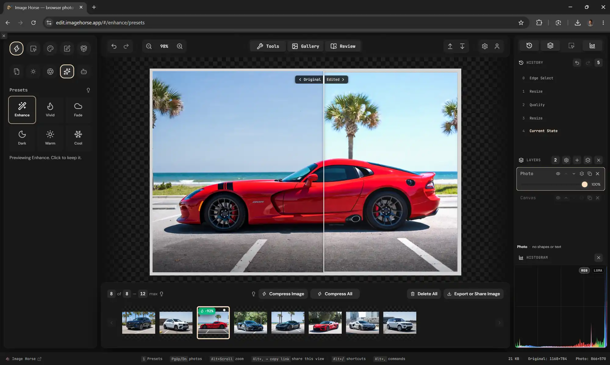

# Image Horse



**Live:** [imagehorse.app](https://imagehorse.app/) &nbsp;·&nbsp; **Editor:** [edit.imagehorse.app](https://edit.imagehorse.app/) &nbsp;·&nbsp; [](https://github.com/chrislanejones/rust-wasm-photo-tool/actions/workflows/ci.yml)

A browser-based image annotation and editing tool powered by **Rust/WASM** for pixel-level operations, **React + TypeScript** with **Zustand** state stores for the UI, and **Convex** for optional cloud persistence. Edits run locally in WebAssembly and your originals + edits live in the browser's **IndexedDB** — your pixels never leave the tab unless you sign in for persistence or AI features. Includes a **batch editor** that works across a whole gallery in one pass — stamp a logo, apply text, bulk-rename by pattern, or name every photo from what is actually in it with a local describer that needs no account and no per-image cost.

> Previously called **Clone Stamp App** — the app grew well beyond its origins as a single clone stamp tool.

## Quick start

Needs Node + [pnpm](https://pnpm.io/), and the Rust toolchain plus
[`wasm-pack`](https://rustwasm.github.io/wasm-pack/) to build the engine.

```bash
pnpm install
pnpm run build:wasm   # compile the Rust engine -> pkg/  (required before first run)
pnpm run dev          # editor at localhost:5173
```

`pnpm run build` bundles whatever is already in `pkg/` — it does **not** rebuild the
engine. After changing anything under `src/`, run `build:wasm` again, or use
`pnpm run build:all` to do both. A stale `pkg/` looks exactly like a broken feature.

Convex and Clerk are optional: with no keys set the app runs fully logged-out,
which is a supported path and not a degraded one. Full setup, deploy notes and
environment variables → **[1. Getting Started](docs/01-Getting-Started.md)**.

## Documentation

The docs read like a book: numbered chapters, each linking to the next.
Start at **[the Contents](docs/README.md)**, or jump in:

1. **[Getting Started](docs/01-Getting-Started.md)** — install it, run the app and the marketing site, set up Convex, deploy.
2. **[Architecture](docs/02-Architecture.md)** — how it fits together: layers and compositing, why one WASM binary, the Rust ↔ Convex bridge.
3. **[File Map](docs/03-File-Map.md)** — where everything lives, in both the Rust crate (`src/`) and the React app (`app/src/`).
4. **[Features](docs/04-Features.md)** — what it can actually do, end to end.
5. **[Keyboard Shortcuts](docs/05-Keyboard-Shortcuts.md)** — every binding. The in-app modal (`Alt + /`) is authoritative for the tool digits; this mirrors it.
6. **[UI](docs/06.0-UI.md)** — the UI rules, what the UI is built from, and the UI work that shipped. Sections 6.1–6.3 are the rules, the inventory and the exceptions.
7. **[OpenRaster (.ora)](docs/07-OpenRaster.md)** — layered interchange with Krita, GIMP and friends: how import/export work, and why this format.
8. **[Plugins](docs/08-Plugins.md)** — features from outside the app, added from Settings → Plugins and kept on the device; the Photoshop PSD plugin lives in its own repository, and this is how to write one.
9. **[MCP](docs/09-MCP.md)** — connecting Claude or Cursor to your Image Horse account: the tools, the limits, and what turns it on.
10. **[AI Reference Storage](docs/10-AI-Reference-Storage.md)** — how a Create AI Image job owns the images you attach, and when they're deleted.
11. **[CI](docs/11-CI.md)** — the workflow jobs, the deploy sentinel, the static guardrails, and the local git hooks.
12. **[Deploying](docs/12-Deploying.md)** — the two Vercel projects, the prerender step that makes the marketing site indexable, DNS, and how the editor came off Netlify.
13. **[Vercel Builds](docs/13-Vercel-Builds.md)** — which pushes each Vercel project skips building, and why.
14. **[The AppShell Refactor](docs/14-AppShell-Refactor.md)** — how the biggest files get smaller.
15. **[The Engine Worker](docs/15.0-Engine-Worker.md)** — why the image engine runs in a web worker, and the three notes that got it there.
16. **[Accessibility](docs/16-Accessibility.md)** — keyboard, focus, screen-reader names and announcements, reduced motion: what the editor does and how it's tested.

At the back: the **[Change Summary](docs/Change-summary.md)** (every release, dated),
the **[decisions](docs/adr/INDEX.md)** behind the design, the
**[Parking Lot](docs/PARKING_LOT.md)** of known problems, and an
**[archive](docs/archive/README.md)** of superseded notes, each one saying what went stale about it.

## Tech Stack

- **Rust** — WASM processing layer (`wasm-bindgen`, `png` crate, `ab_glyph` fonts, SIMD128 kernels)
- **React 19** — UI framework (19.3.x, pinned through the pnpm catalog)
- **TypeScript** — Type safety
- **Zustand** — Client state management (UI / tool / gallery stores; IndexedDB-persisted prefs)
- **Vite** — Build tool with WASM support (`vite-plugin-wasm` + top-level await)
- **Tailwind CSS v4** — Utility styling via semantic design tokens; core utilities only, variants via cva
- **Radix UI** — Accessible primitives (Dialog, Tooltip, Context Menu)
- **Framer Motion** — Panel animations
- **Lucide React** — Icons
- **Sonner** — Toast notifications
- **emoji-mart** — Emoji picker (stamp tool)
- **JSZip** — Client-side ZIP (batch export)
- **IndexedDB** — Local-first storage (originals, edits, gallery); **Dexie** content layer + Zustand persist adapter
- **Convex** — Real-time database + auth + serverless functions
- **Clerk** — Authentication, wired to Convex through `ConvexProviderWithClerk` (`convex/react-clerk`)
- **Stripe** — Payments / billing, called over raw REST from Convex (no SDK dependency)
- **Replicate** — AI image models (background removal, restore) via Convex

## The marketing site

`marketing/` — the site at **[imagehorse.app](https://imagehorse.app/)**:
home, tool pages, architecture, features, pricing, Trail Log and what is in the works. Vite + React 19 + react-router,
plain CSS off the tokens in `src/tokens.css` (no Tailwind, no UI library).
The marketing Vercel project uses Root Directory `marketing` and
`marketing/vercel.json`, publishing `marketing/dist`. The root `vercel.json`
builds the editor at **edit.imagehorse.app**. See [marketing/README.md](marketing/README.md).

```bash
pnpm run dev:marketing      # local
pnpm run build:marketing    # production → marketing/dist
node marketing/scripts/gen-trail-data.mjs   # refresh the derived data (see below)
```

Its numbers are derived, never typed. `src/data/commits.ts` (the Trail Log's
commit squares) and `src/data/features.ts` come from `git log` and
`docs/Features.md` via `scripts/gen-trail-data.mjs` — **run it on every release**,
or the graph quietly keeps drawing last month. `src/data/releases.ts` is the
changelog itself, so that one is hand-written: add the new release at the top.

## Changelog

Latest release below. Full dated history → **[docs/Change-summary.md](docs/Change-summary.md)**.

### v9.82 — 2026-11-26

**Happy Thanksgiving, plus a full checkup.**

A "Happy Thanksgiving" garland hangs under the top bar and over the start
screen this week: pennants, a pumpkin, a maple leaf and a turkey. Click
the **×** and it stays closed for the year. It takes itself down after
Sunday and comes back next November without a release.

Everything from v9.70 to v9.81 also got a full QC pass on a production
build: 345 end-to-end tests, nine new checks, and every link on the
marketing site. Nothing had broken.

Two small fixes came out of it. With a recipe picked in Export, the footer
used to say how compressed your image was, and that number was about a
different file, because the recipe makes its own. Now the footer leaves it
out while a recipe is picked. And the color dialog's wheel and square told
screen readers "Colour"; they say "Color" now.

Under the hood: Dexie 4.4.7, Convex 1.51, Playwright 1.65.1 and
tailwind-merge 3.7.1. A photo saved by the old version opens fine in the
new one.

Full release notes: [Change Summary](docs/Change-summary.md) ·
[Trail Log](https://imagehorse.app/trail-log).


## License

MIT
