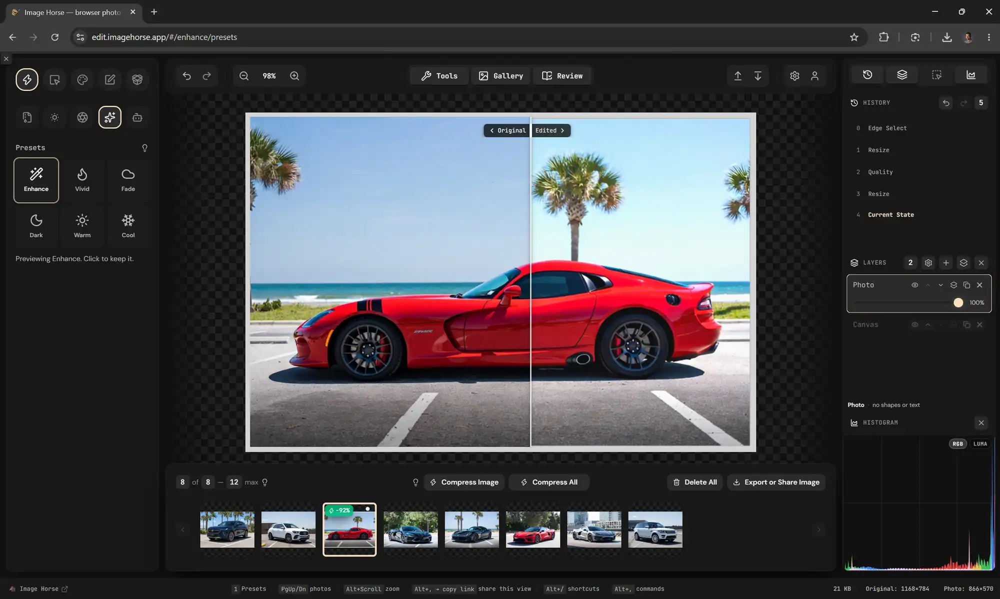

# Image Horse



**Live:** [imagehorse.app](https://imagehorse.app/) &nbsp;·&nbsp; **Editor:** [edit.imagehorse.app](https://edit.imagehorse.app/) &nbsp;·&nbsp; [](https://github.com/chrislanejones/rust-wasm-photo-tool/actions/workflows/ci.yml)

A browser-based image annotation and editing tool powered by **Rust/WASM** for pixel-level operations, **React + TypeScript** with **Zustand** state stores for the UI, and **Convex** for optional cloud persistence. Edits run locally in WebAssembly and your originals + edits live in the browser's **IndexedDB** — your pixels never leave the tab unless you sign in for persistence or AI features. Includes a **batch editor** that works across a whole gallery in one pass — stamp a logo, apply text, bulk-rename by pattern, or name every photo from what is actually in it with a local describer that needs no account and no per-image cost.

> Previously called **Clone Stamp App** — the app grew well beyond its origins as a single clone stamp tool.

## Quick start

Needs Node + [pnpm](https://pnpm.io/), and the Rust toolchain plus
[`wasm-pack`](https://rustwasm.github.io/wasm-pack/) to build the engine.

```bash
pnpm install
pnpm run build:wasm   # compile the Rust engine -> pkg/  (required before first run)
pnpm run dev          # editor at localhost:5173
```

`pnpm run build` bundles whatever is already in `pkg/` — it does **not** rebuild the
engine. After changing anything under `src/`, run `build:wasm` again, or use
`pnpm run build:all` to do both. A stale `pkg/` looks exactly like a broken feature.

Convex and Clerk are optional: with no keys set the app runs fully logged-out,
which is a supported path and not a degraded one. Full setup, deploy notes and
environment variables → **[Getting Started](docs/Getting-Started.md)**.

## Documentation

- **[Getting Started](docs/Getting-Started.md)** — install it, run the app and the marketing site, set up Convex, deploy.
- **[Architecture](docs/Architecture.md)** — how it fits together: layers and compositing, why one WASM binary, the Rust ↔ Convex bridge.
- **[File Map](docs/File-Map.md)** — where everything lives, in both the Rust crate (`src/`) and the React app (`app/src/`).
- **[Features](docs/Features.md)** — what it can actually do, end to end.
- **[Keyboard Shortcuts](docs/Keyboard-Shortcuts.md)** — every binding. The in-app modal (`Alt + /`) is authoritative for the tool digits; this mirrors it.
- **[OpenRaster (.ora)](docs/OpenRaster-Export-Import.md)** — layered interchange with Krita, GIMP and friends: how import/export work, and why this format.
- **[Plugins](docs/Plugins.md)** — features from outside the app, added from Settings → Plugins and kept on the device; the Photoshop PSD plugin lives in its own repository, and this is how to write one.
- **[CI](docs/CI.md)** — the workflow jobs, the deploy sentinel, the static guardrails, and the local git hooks.
- **[Deploying](docs/Deploying.md)** — the two Vercel projects, the prerender step that makes the marketing site indexable, DNS, and how the editor came off Netlify.
- **[Change Summary](docs/Change-summary.md)** — the full dated release history.
- **[UI Nights 9–15](docs/UI_NIGHTS_09_15.md)** — gallery, preview loading and Settings accessibility improvements shipped in v9.27.
- **[Next UI pass](docs/ui-state-v4/08-v927-integration.md)** — photo switching, document controls, Pen/Pins, masks, history and error feedback, under review against v9.27.

Design decisions live in **[docs/adr/](docs/adr/INDEX.md)**. Superseded investigations and planning notes are kept in **[docs/archive/](docs/archive/README.md)** rather than deleted — each one says what went stale about it.

## Tech Stack

- **Rust** — WASM processing layer (`wasm-bindgen`, `png` crate, `ab_glyph` fonts, SIMD128 kernels)
- **React 19** — UI framework (19.2.x, pinned through the pnpm catalog)
- **TypeScript** — Type safety
- **Zustand** — Client state management (UI / tool / gallery stores; IndexedDB-persisted prefs)
- **Vite** — Build tool with WASM support (`vite-plugin-wasm` + top-level await)
- **Tailwind CSS v4** — Utility styling via semantic design tokens; core utilities only, variants via cva
- **Radix UI** — Accessible primitives (Dialog, Tooltip, Context Menu)
- **Framer Motion** — Panel animations
- **Lucide React** — Icons
- **Sonner** — Toast notifications
- **emoji-mart** — Emoji picker (stamp tool)
- **JSZip** — Client-side ZIP (batch export)
- **IndexedDB** — Local-first storage (originals, edits, gallery); **Dexie** content layer + Zustand persist adapter
- **Convex** — Real-time database + auth + serverless functions
- **Clerk** — Authentication, wired to Convex through `ConvexProviderWithClerk` (`convex/react-clerk`)
- **Stripe** — Payments / billing, called over raw REST from Convex (no SDK dependency)
- **Replicate** — AI image models (background removal, restore) via Convex

## The marketing site

`marketing/` — the site at **[imagehorse.app](https://imagehorse.app/)**:
home, tool pages, architecture, features, pricing, Trail Log and what is in the works. Vite + React 19 + react-router,
plain CSS off the tokens in `src/tokens.css` (no Tailwind, no UI library).
The marketing Vercel project uses Root Directory `marketing` and
`marketing/vercel.json`, publishing `marketing/dist`. The root `vercel.json`
builds the editor at **edit.imagehorse.app**. See [marketing/README.md](marketing/README.md).

```bash
pnpm run dev:marketing      # local
pnpm run build:marketing    # production → marketing/dist
node marketing/scripts/gen-trail-data.mjs   # refresh the derived data (see below)
```

Its numbers are derived, never typed. `src/data/commits.ts` (the Trail Log's
commit squares) and `src/data/features.ts` come from `git log` and
`docs/Features.md` via `scripts/gen-trail-data.mjs` — **run it on every release**,
or the graph quietly keeps drawing last month. `src/data/releases.ts` is the
changelog itself, so that one is hand-written: add the new release at the top.

## Changelog

Latest release below. Full dated history → **[docs/Change-summary.md](docs/Change-summary.md)**.

### v9.27 — 2026-10-11

**The gallery loads steadily, Settings works from the keyboard, and a pen stroke selects on its ink.**

Welcome Back, Shared and Batch keep previews in place while images decode.
Gallery rows scroll without overlapping, and hovering one photo reveals its
controls. Enter and Space work on Remove and Select; selection keeps the
current photo open. The gallery shows the current count and the 12-photo demo limit.

Settings has named tabs with Up/Down and Home/End navigation, and readable help
text in both themes. If a section disappears while Settings is open, its pane and
keyboard entry point return to General. An unfilled freehand stroke selects along its segments
instead of the empty space inside its bounds. Every eligible browser test now
runs in CI, across two jobs.

[UI Nights 9–15](docs/UI_NIGHTS_09_15.md) records the work and validation.
The [Trail Log](https://imagehorse.app/trail-log) has the release notes and
commit squares; [what is in the works](https://imagehorse.app/in-the-works)
shows the next pass still under review.


## License

MIT
