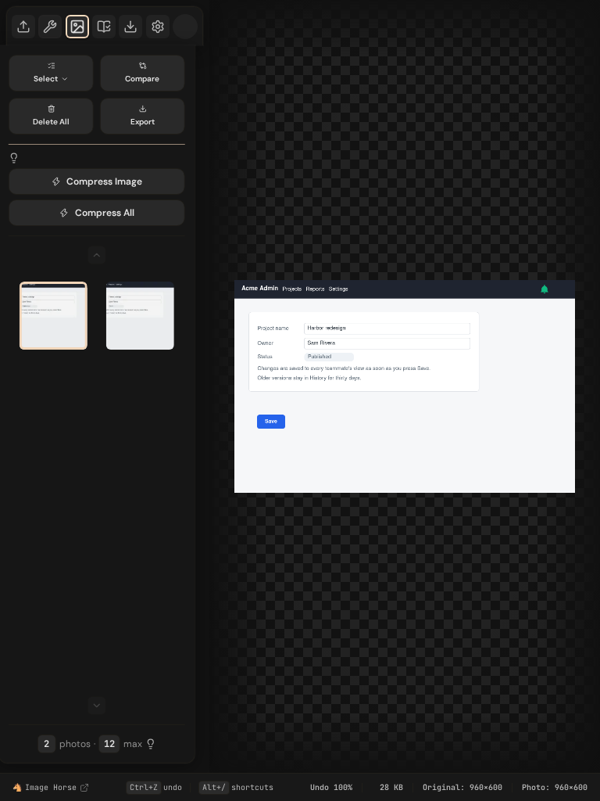
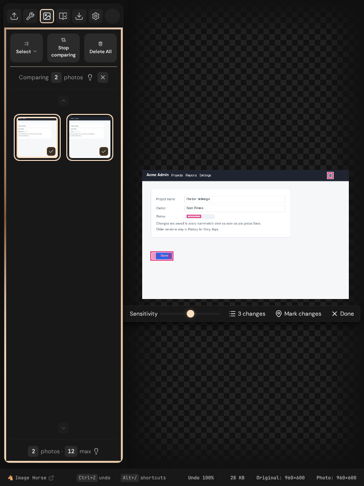
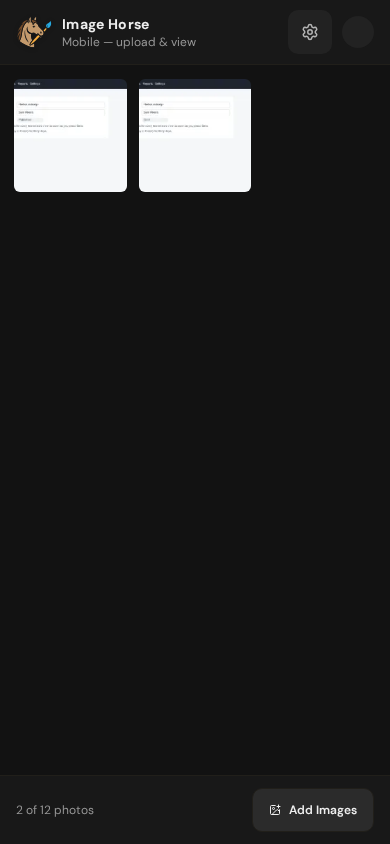

# Day log — 11-15-2026

Read this first. Four parts, one branch and one PR each, nothing merged or deployed.

## Preflight

| Check | Result |
|---|---|
| `edit.imagehorse.app` alias | **v9.63** deployment `dpl_FFk7aueWi1FbMSgErSVkJF912Quj`, Ready, master `a794a3bd` |
| master head `371e1895` (#470) | Its production build is Canceled. #470 only changed tests, so the path skip canceled it. Nothing to deploy |
| Verdict | **PASS**: the live editor is master's code |

## Parts

| Part | Branch | PR | State |
|---|---|---|---|
| 1 Find duplicates | `feat/find-duplicates` | **#473** | **done**, open, `c38ab4e4` |
| 2 Auto tone | `feat/auto-tone` | **#476** | **done**, open, `7418cb8e` |
| 3 More rename tokens | `feat/rename-tokens` | **#474** | **done**, open, `39f1a67a` |
| 4 Compare on the compact bar | `feat/compact-bar-compare` | **#475** | **done, with a change**, open, `a644d4d5` |

## Log

- Started 11-15. Parts run in pairs (1+3, then 2+4) so two engine builds never run at once.
- Parts 1 and 3 finished. Both pushed once to GitHub and Codeberg. Neither is merged.

## Part 1 — Find duplicates (#473)

**Fixtures** (`e2e/fixtures/dupes/`): drawn scenes only, never real photos. `make-fixtures.mjs` generates them in Chromium with seeded noise.

| Scene | What it is |
|---|---|
| lake | the same photo at 960, 640 and 320 px, a q 0.55 JPEG re-save, a 1-px crop |
| beach | a burst pair (the walker moves 12 px, exposure +2) |
| pier | two different shots of the same scene (a step right, zoomed 1.4×) |

**Threshold: 6 bits** (Hamming distance, 64-bit dHash).

| Pair | Measured distance |
|---|---|
| Same photo: sizes, re-save, crop | 0–2 bits |
| Burst pair | 1 bit |
| Same pier, two shots | **11** bits, stays apart |
| Different scenes | 10–21 bits |

6 sits in the gap, 4 bits from each side. A pair also needs average colors within 24 levels, so a black frame can't match a white one.

The engine changed while tuning: with a plain darker/brighter test, noise on a flat sky flipped 17 of 64 bits. Now a bit counts only when the right-hand cell is brighter by more than 1 level.

| 200-photo timing | ms |
|---|---|
| Hash 200 thumbnails | ~22 |
| Group them | ~2 |
| Decode 200 thumbnails in Chromium | 65–73 |
| **Total** | **~100** (budget 1,000) |
| Real dialog, 9 photos, first open / cached | 31–35 / 9 |

The gallery caps at 100 photos, so the 200-photo number was timed in pieces, not through the dialog.

| Gate | Result |
|---|---|
| vitest | 2,287 / 2,287 |
| e2e (find-duplicates, bulk-night, batch-exceptions) | 12 / 12 |
| cargo fmt, clippy, test (plain and tiles) | green |
| wasm | **960,152 → 962,237 B (+2,085)** |

- **Deviation:** "Tick N in gallery" *replaces* the selection instead of adding to it. Adding could leave an earlier-ticked Keep photo in Delete Selected.
- The fingerprint cache is in memory. Saving it would be a new IndexedDB field, so it would need a Dexie migration (your call).
- The engine changed, so `imagehorse-qc` is owed before v9.64.

## Part 3 — More rename tokens (#474)

| Token | Example output |
|---|---|
| `{name}` | beach |
| `{original}` | IMG_4021 (the uploaded name) |
| `{n}` | 01 |
| `{date}` | 2024-05-01 (EXIF, else the file's date, else today) |
| `{date:YYYYMMDD-HHmm}` | 20240501-1030 |
| `{width}` / `{height}` | 4032 / 3024 |
| `{ext}` | jpg |
| `{w}` / `{h}` (old recipe tokens, still work) | 1080 / 1350 |

- Batch › Rename, AI Rename and the export recipes now share one formatter.
- Batch › Rename moved into its own file. The `BatchSettings.tsx` line cap went **down**, from 1,428 to 1,276.
- vitest: 2,309 pass. e2e: 10 / 10.
- **The file date isn't stored.** It's kept in memory from upload, so after a reload a photo with no EXIF date gets today's date.
- Byte-identical uploads share one stored record, so both get the first one's `{original}`.

## Part 4 — Compare on the compact bar (#475)

**This differs from the spec, for two reasons:**

| Spec asked | What shipped | Why |
|---|---|---|
| A button on the compact master bar | A **Compare** tile in the compact Gallery tab, beside Select and Delete All | The strip has **238 px** of room and eight 30 px buttons need **240 px**, so it's already full |
| e2e at **390 px** | e2e at **768 px** | Below 600 px the phone layout (`MobileShell`) replaces the editor and never loads the engine, so there's nothing to compare on |

- **Same action as the wide button:** `toggleCompareMode` now takes a layout. The wide bar opens the gallery strip; the tile opens the master bar's Gallery tab.
- The label flips to "Stop comparing". The tile is keyboard-reachable and shows its focus ring (the e2e checks both).

| Result | Value |
|---|---|
| New e2e on master | **0 / 1** (red) |
| `screenshot-compare.spec.ts` with the PR | **17 / 17** |
| vitest | 2,267 / 2,267 |
| `imagehorse-qc` | not owed (no canvas or engine change) |

Screenshots (synthetic fixtures):

## Part 2 — Auto tone (#476)

Both fixtures are 128×96 and built from a formula. The numbers are luma at 0.5% / 50% / 99.5%, plus the mean.

| Fixture | Before | After | Auto picked |
|---|---|---|---|
| Dark | 8 / 45 / 115, mean **48.2** | 4 / 91 / 255, mean **99.5** | Brightness +100, Contrast 193, Shadows −20, Highlights −60 |
| Already good | 5 / 128 / 253, mean 127.0 | 0 / 127 / 253, mean 126.0 | Brightness −1, Contrast 103, Shadows 0, Highlights 0 |

- The already-good photo was allowed to move up to 8 levels. The most any point moved was **5**.
- The dark photo clipped 0.24% to black and 0.57% to white (the target was 0.5% each).

| Check | Result |
|---|---|
| One Ctrl+Z | restores the exact original (same image hash), sliders back to neutral |
| Reload + Resume | Auto's result is still there; Ctrl+Z goes back through the op log; redo brings it back |
| Op log | one ordinary Adjustments op, **no new op, no format change** |
| Paste dialog | new line: "Auto tone pastes the values it picked, not Auto itself." |
| wasm | **960,152 → 965,755 B (+5,603)** |
| cargo test (plain / tiles) | 559 / 853 pass |
| e2e (auto-tone, oplog-adjustments-undo, copy-paste-look) | 5 / 5 |

- On a document with several layers, Auto reads only the active layer.
- The engine changed, so `imagehorse-qc` is owed before v9.64.

## For PARKING_LOT (not edited; each needs your call)

| From | Item |
|---|---|
| 1 | Duplicate fingerprints aren't saved; saving them needs a Dexie migration |
| 1 | Groups chain (A~B, B~C puts A, B, C together); rotated or mirrored copies aren't found |
| 1 | The hash reads the current thumbnail, so a heavily edited photo no longer matches its original |
| 2 | Auto tone on a multi-layer document reads only the active layer |
| 3 | The `{date}` file date isn't kept after a reload (needs a stored field) |
| 3 | AI Rename info text still says "colour" / "recognise" |
| 4 | The compare lightbulb says "the top bar's Compare button", which the compact layout doesn't have |
| 4 | Compact layout while comparing: two "Stop comparing" controls (the tile and the status X) |

## Merge notes

- **#473 and #476 both change the engine** and both start from 960,152 B. Merge one, then check the other for a `src/lib.rs` conflict and re-quote its wasm size.
- `imagehorse-qc` is owed for v9.64 (#473 and #476 touch the engine and canvas).

## CI when I stopped

| PR | CI | Note |
|---|---|---|
| #473 | 18 pass, 1 rerunning | E2E shard 1 failed on `callout-leader.spec.ts:163` (Align ▾ in a multi-select group). That's canvas text, not the gallery. Locally: **1 fail in 11** runs on #473, **0 in 8** on a control branch. Probably a flake, not proven. The failed shard is rerunning |
| #474 | 17 pass, 1 rerunning | E2E shard 1 failed on the gallery-skeleton "watched every frame" timing test. Locally on #474: **30 / 30** pass. A flake. The shard is rerunning |
| #475 | **all green** | |
| #476 | 16 pass, 2 pending | |
| master | `cargo audit` + Convex deploy red | Both were red before today; e2e on master is green |

Check `gh pr checks <N>` for the reruns before merging.

## When you're back

1. Merge **#472** first (last night's).
2. Then today's: #474 and #475 touch no engine code; #473 and #476 both change the engine. After merging one, re-check the other.
3. Then #471 and #455, run `imagehorse-qc`, and cut **v9.64**.
