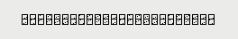

# Day log — 11-21-2026 night: Redact on every screenshot, and location leaves only when you say so

| What | Where it ended |
|---|---|
| Preflight | `edit.imagehorse.app` on a **Ready** production deploy from master `6322ad9a` (built 11-20 23:58) |
| #494's red shard | An existing flake, not #494's. **20/20** on #494 and **20/20** on master at 4× CPU; rerun green. Nothing pushed to #494 |
| PR A, Batch › Redact (230) | `feat/batch-redact`, pushed once, not merged |
| PR B, Camera info on export (231) | `feat/export-camera-info`, pushed once, not merged |
| ADR-108 | Draft, in both PRs (byte-identical, so they merge cleanly) |

## 1. #494's red shard

| Question | Answer |
|---|---|
| Spec and line | `e2e/callout-leader.spec.ts:156`, §4 "Align ▾ on the callout alone (to the canvas)" |
| What the screenshot showed | The label moved; the leader's tail stayed (y1 466 against about 874) |
| 20× at 4× CPU on #494 (`56faca22`) | **20 passed, 0 failed** |
| 20× at 4× CPU on master (`6322ad9a`) | **20 passed, 0 failed** |
| Verdict | The known callout-leader §4 flake, already red on master and 4 branches since 11-18. Not widened, not touched |
| CI after a rerun | #494 **18 pass, 2 skipping, 0 fail** |

It doesn't reproduce locally under load on either tree, so it needs a CI-only look
(the failure screenshots #494 now keeps are where to start). Still parked.

## 2. Batch › Redact (PR A)

| Ask | Result |
|---|---|
| A Batch tile: drag a box, Pixelate · Blur · Solid, same place on every photo, Main \| Exceptions | Yes. A group with no boxes is skipped, so an Exception is left alone until it gets boxes |
| Where "the same place" is | Default **Same spot**: fractions of the photo, because 1x and 2x screenshots of one screen are the common set and pixels would be off by 2×. Option **Pinned to a corner**: px size and distance from one of the nine Placement cells |
| Up to 10 boxes | Yes |
| Reuse the brushes' engine code | Pixelate / Solid = the rectangle shape's mosaic / solid fill (the Shapes › Fill › Pixelate box); Blur = the Blur brush's own stroke walked over the box. **No new engine code, no new op** |
| Open photo: one undo step on the op log | Yes (`ShapeAdd` / `Op::Blur`, joined with `continue_step`). No ADR stop: no new op |
| Not-open photos: from the stored original, no undo, the panel says so | Yes, plus two refusals: a photo with **its own edits** is skipped (its saved pixels would paint over the redaction), and the open photo needs **one content layer** |
| Real redaction, 12 px text unreadable | Floors: block ≥ **12** px, blur ≥ **20**. Measured on the built engine: no ink pixel survives (none darker than 96), box SD under ¼ of the text's. A blur at 4 fails the same test |

| Test | Red (master) | Green (branch) |
|---|---|---|
| `lib/redactEngine.test.ts` (built wasm, 12 px ink) | module missing | **11/11** |
| `lib/batchRedact.test.ts` (placement, floors, blur path) | module missing | **7/7** |
| `e2e/batch-redact.spec.ts`: 1440 / 2880 / 1200 shots, 2 boxes, an Exception, one undo, reload | **3 failed** (no Redact tile) | **3/3** |

Crops at 100%, the open 1440 shot and the stored 2x one (in `docs/day-logs/2026-11-22/`):

| Before | Pixelate | Blur | Solid | 2880, stored |
|---|---|---|---|---|
|  |  |  |  |  |

Blur hides the letters but not the rhythm of the words. Solid is the strongest of
the three; ADR-108 says so.

## 3. Camera info on export (PR B)

**The default was not "Keep all".** The prefs default to `exifKeep: false` + strip
`all`, so anyone who never opened Settings › Security already exported **no EXIF**.
That default is kept. ADR-108 puts the real question: loosen it to Remove location?

| Ask | Result |
|---|---|
| Keep all · Remove location · Remove all in Download, Download All and recipes, remembered | Yes. Stored in the two prefs Security already had: no new field, no prefs bump, syncs |
| Remove location: no GPS, keep date / camera / orientation | Yes, on every path. Re-encoded exports used to ignore the scope; they now scrub the GPS IFD before the transplant |
| Remove all: nothing but what keeps it upright | Re-encoded: no EXIF (already upright). Verbatim JPEG with a turn: a 26-byte Orientation-only TIFF instead of a lossy re-encode |
| TS and Rust Beta, same bytes | Yes. Oracle **281 → 373 rows**; all 281 old goldens unchanged. Engine 969,240 → **971,432 B** |
| Batch › Strip info, confirm first | Yes: "This removes location from 12 photos. It can't be undone." Lossless. Rewrites `originalKey` **and** `uploadKey`, or a Keep-all export would bring GPS back |
| Default stays as is | Yes (Remove all). The case for Remove location is in ADR-108 |

| Found on the way | Fix |
|---|---|
| **Keep EXIF wrote turned photos sideways.** Re-encoded pixels are upright, but the transplant kept Orientation 6 | The transplant sets Orientation to 1. Upright photos are byte-identical to before |
| The phone's Save ignored the EXIF setting | Honors Camera info (a scrub, no re-encode, no engine) |

| Test | Red (master) | Green (branch) |
|---|---|---|
| `lib/exif/cameraInfo.test.ts` | module missing | **13/13** |
| `lib/batchStripInfo.test.ts` | — | **6/6** |
| EXIF oracle, TS + built wasm + `cargo test` | — | **373/373** each |
| `e2e/camera-info.spec.ts`: each choice, remembered, Rust Beta, recipe, Strip info | **4 failed** (no Camera info control) | **4/4** |

The dump of each choice, read by ImageMagick (`identify`), not by our own parser:
`docs/day-logs/2026-11-22/camera-info-dump.txt`. In short:

| File | GPS | Date + camera | Orientation |
|---|---|---|---|
| Original | yes | yes | 1 / 6 |
| Remove location | **none** | kept | kept |
| Remove all, upright | none | **none** | none |
| Remove all, turned | none | none | **6 only** |
| Keep all, re-encoded from a turned photo | yes | yes | **1** |

exiftool isn't installed. To check with it: `sudo apt install libimage-exiftool-perl`.

## Gates

| Gate | PR A | PR B | A + B merged (local sim) |
|---|---|---|---|
| tsc | 0 | 0 | 0 |
| vitest | **2482/2482** | **2483/2483** | **2501/2501** |
| lint | 0 errors (54 warnings, as master) | 0 errors (54) | 0 errors (54) |
| guardrails | OK | OK | OK |
| Batch + export e2e | **30 passed**, 2 skipped as on master | **41 passed**, 2 skipped | — |
| cargo fmt / clippy / exif oracle | no Rust change | OK / OK / **373** | — |

Lint was red once on both: `BatchSettings.tsx` is capped at 1276 lines and master sat
exactly there. Rather than raise the cap, its hand-kept copy of the Batch tile list
now comes from `toolModes.ts` (`batchToolModes()`), the list the palette and routes
already use. 1276 → 1269 on each PR, **1272** merged.

## Merging A and B

Merged locally, A then B: **one conflict**, the `BATCH_MODES` line in
`stores/useToolStore.ts`; everything else (including the identical ADR-108 and the
identical `batchToolModes` change) merges clean. The resolution is
`[…, "resize", "redact", "stripinfo"]`, and the merged tree passes every gate above.

## Parked

- Callout-leader §4 CI flake: 0/40 locally at 4× CPU, so a CI-only look.
- Redact on a photo with several layers is refused rather than handled.
- Remove all on a turned **WebP or PNG** verbatim file keeps no orientation tag.
- `canvas/tools` changed: **imagehorse-qc** is owed before v9.67.

---

# Day log — 11-22-2026 evening: callout-leader §4, found

| What | Where it ended |
|---|---|
| Ask | Find why §4 fails after the reload (Undo lands on a layer with no shapes and a text with a new id). Cause first, fix only if small |
| Cause | **Found.** `followLabels` read the shapes and the texts in two worker round trips. A Ctrl+Z (or Ctrl+Shift+Z) that lands between them makes it redraw a leader that needed nothing, onto the rewound log |
| Fix | One line in `hooks/usePinSteps.ts`: both reads go out in one tick (`Promise.all`). No op-log format change, no engine change, no Convex |
| Red-first test | `hooks/usePinSteps.test.ts`: real engine behind a FIFO port, undo posted while the first read's reply is in flight. Red: log 12 → **8** ops, broken after the redo. Green after the fix |
| Branch | `test/callout-leader-s4-cause`, worktree `~/ai-repo/callout-leader-1122`, pushed once, not merged |

## 1. Instrumentation (test-only, kept behind a flag)

`e2e/oplog-dump.ts`, used by `callout-leader.spec.ts`. Off unless `E2E_OPLOG_DUMP=1`,
so a normal run and CI are unchanged, and e2e code never ships.

| Dump | When |
|---|---|
| `oplog-0-after-undo-redo` | After the pre-reload Ctrl+Z / Ctrl+Shift+Z (first named `0-after-act`; it was never right after the act, renamed) |
| `oplog-1-before-reload` | After the 6 s wait, just before `page.reload()` |
| `oplog-2-after-restore` | After Resume editing and the probe |
| `oplog-3-after-undo` / `-FAILED` | After the undo that §4 fails on |
| `oplog-9-failed` | Any other failure |

Each holds the live op log (length, cursor, generation, status, broken, the last 10
ops decoded by variant with their `SameGesture` markers), the undo snapshot stack
(count, labels, text ids of the top 3), the live shapes and texts, and the disk:
op-log manifest, chunks (ops decoded), keyframes, and the archive record. From the
third run on it also holds a **call trace**: an init script wraps
`Worker.prototype.postMessage` and records every engine call and key press in post
order, which is execution order because the worker drains FIFO. It never calls the
engine, so it does not move the timing it watches.

The engine has no accessor for a snapshot's SHAPES, so the top-3 entries carry text
ids only; shapes come from the op frames and the archive.

**A mistake of mine, caught on run 1.** The dump opened `image-horse-edits` with no
version before the app had created it. That creates it empty at version 1, and the
app's `open(name, 1)` then gets no upgrade and no store: every autosave failed
("One of the specified object stores was not found") and resume could not open the
photo. Run 1 was stopped at 4/200 and thrown out. The dump now opens only databases
`indexedDB.databases()` already lists.

## 2. The runs

| Run | Setup | Result |
|---|---|---|
| 1 | 4× CPU, one worker, IDB bug in the dump | **stopped**, invalid (see above) |
| 2 | 4× CPU, one worker (as asked) | **200/200 passed**, no broken log in any dump |
| 3 | 4× CPU, one worker, `taskset -c 0` (the 10-31 repro), call trace on | **5 failed / 195 passed** |
| 4 | Run 3's setup, with the fix | **200/200 passed** (50/50 for each of the four), no broken log, nothing written between Undo and Redo in any trace |

Run 2 matches 11-21 (0/40 at 4×): CPU throttling alone does not open the window here.
Pinning the browser to one core does.

Run 3, every failure:

| Run | Failed at | Calls between the pre-reload `undo()` and `redo()` | Log after | Resume path |
|---|---|---|---|---|
| Align alone #24 | the undo after the reload | `continue_step`, `update_shape_annotation(2, …385.5,443 → 303.2,866.3)` | **8 ops, broken** | archive |
| Align alone #34 | same | same | **8, broken** | archive |
| Align alone #44 | same | same | **8, broken** | archive |
| Nudge #44 | same | `continue_step`, `update_shape_annotation(2, …351,421 → 313.5,449.7)` | **8, broken** | archive |
| Nudge #10 | `toEqual(after)` after the reload | none; the same write came just AFTER `redo()` (351,431 → 315.9,444.1) | 13, healthy | op log, wrong leader |
| 195 passing | — | **none** | 12–13, healthy | op log |

Passing dumps kept: all 195 in `/tmp/cl-run3/` (not committed: local scratch).
The only `update_shape_annotation` left in run 4's traces is in the 50 Placement
runs, where the leader is meant to follow the Text tool's move; none sits between
an `undo()` and a `redo()`.

## 3. What differs, and why

Compare Align alone #24 (failing) with any passing Align alone run. The passing log
is 12 ops: the callout's 7 (`TextAdd · SG · TextAlign · SG · ShapeAdd pin · SG ·
ShapeAdd leader`) and the Align's 5 (`TextEdit · SG · ShapeEdit pin · SG · ShapeEdit
leader`). Nothing writes between the test's Ctrl+Z and Ctrl+Shift+Z, both go
through the log, it is saved, and the resume replays it. In the failing run the
gesture markers are all in the right place and the autosave timing is not involved:
an op **is missing because a stray one replaced it**. Between the Ctrl+Z and the
Ctrl+Shift+Z the Text tool's leader follow (`useTextTool` → `followLabels`) wrote a
leader whose tail sits on the label's pre-Align edge and whose head sits on the
pin's post-Align outline. It had read the shapes BEFORE the undo and the texts
AFTER it, in two separate worker round trips, so it saw a pin that had moved and a
label that had not, and "followed". That write landed at the rewound cursor (7),
which drops the redo tail: the log goes from 12 ops to 8. The Ctrl+Shift+Z then
finds the log at its end, falls back to snapshot redo, and `restore_snapshot` marks
the log broken. The layer looks right (the snapshot is complete), so everything
before the reload passes. A broken log is never saved, the resume finds no op log,
and it uses the archive. The archive's undo steps (`SnapEntry`) store texts and no
shapes, and each restored text gets a fresh id, so the first Ctrl+Z after the
reload lands on a layer with **no shapes and a text with a different id**: the CI
failure exactly. Nudge #10 is the same race on the other side of the redo. Its shape
(label moved, leader off after the reload) matches what 10-31 saw at line 134, but
that CI run left no dump, so that is a match and not a proof. 4× CPU on one core
exposes it because the follow is an effect that runs a render after the Align's
list refresh. Starved of CPU, that render slides until it overlaps the test's next
key press, which comes as soon as the joined poll passes, and each round trip in
the follow gets long enough for a key press to fit between two of them. CI is
where it showed up, and a busy shared runner is the likely reason, not measured
there. A person who moves a callout and presses Ctrl+Z straight away can hit it too.

## 4. The fix

`followLabels` posts both reads in the same tick (`Promise.all`). The worker drains
its port in order, and no key handler runs between two `postMessage` calls in one
synchronous block, so the two reads are adjacent in its queue: an undo lands before
both or after both, the follow sees one state, and in that state the leader already
matches, so nothing is written. Small, no format change, no engine change, so
step 4 applied.

| Test | Before the fix | After |
|---|---|---|
| `usePinSteps.test.ts` "a Ctrl+Z that lands between the follow's reads…" (forced order, real engine) | **red**: `followed: true`, ops **8** (want 12), `broken: true` | **green** |
| `usePinSteps.test.ts`, all 5 | 4/5 | **5/5** |
| e2e §4 ×50 at 4× CPU, one core | **5 failed / 200** (run 3) | **200/200** (run 4) |

## Gates

| Gate | Result |
|---|---|
| `pnpm -C app exec tsc --noEmit` | **0** |
| `pnpm lint` | **0 errors** (54 warnings, as master) |
| `./scripts/guardrails.sh` | **OK** |
| `pnpm -C app test` | **2508/2508**, 276 files |
| Rust | no Rust change |

## Parked (in PARKING_LOT, merged entry)

- The archive's undo steps carry no shapes, so ANY resume that falls back to the
  archive loses shapes from undo. This bug was the way in; the gap is its own fix.
- The follow can still write after a key press that lands between its reads'
  reply and its write. With one consistent read that write only happens when a
  label really moved, and an undo in that window is far narrower; not seen in any run.
- `usePinSteps`' own pin-follow pairs React's shape list with an engine text read.
  Its "leader moved → skip" rule kept it out of every run here; same shape of risk.
- `canvas/tools` touched (a hook): **imagehorse-qc** owed before the next release.
