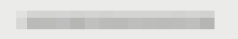
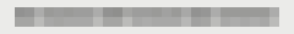

# Day log — 11-21-2026 night: Redact on every screenshot, and location leaves only when you say so

| What | Where it ended |
|---|---|
| Preflight | `edit.imagehorse.app` on a **Ready** production deploy from master `6322ad9a` (built 11-20 23:58) |
| #494's red shard | An existing flake, not #494's. **20/20** on #494 and **20/20** on master at 4× CPU; rerun green. Nothing pushed to #494 |
| PR A, Batch › Redact (230) | `feat/batch-redact`, pushed once, not merged |
| PR B, Camera info on export (231) | `feat/export-camera-info`, pushed once, not merged |
| ADR-108 | Draft, in both PRs (byte-identical, so they merge cleanly) |

## 1. #494's red shard

| Question | Answer |
|---|---|
| Spec and line | `e2e/callout-leader.spec.ts:156`, §4 "Align ▾ on the callout alone (to the canvas)" |
| What the screenshot showed | The label moved; the leader's tail stayed (y1 466 against about 874) |
| 20× at 4× CPU on #494 (`56faca22`) | **20 passed, 0 failed** |
| 20× at 4× CPU on master (`6322ad9a`) | **20 passed, 0 failed** |
| Verdict | The known callout-leader §4 flake, already red on master and 4 branches since 11-18. Not widened, not touched |
| CI after a rerun | #494 **18 pass, 2 skipping, 0 fail** |

It doesn't reproduce locally under load on either tree, so it needs a CI-only look
(the failure screenshots #494 now keeps are where to start). Still parked.

## 2. Batch › Redact (PR A)

| Ask | Result |
|---|---|
| A Batch tile: drag a box, Pixelate · Blur · Solid, same place on every photo, Main \| Exceptions | Yes. A group with no boxes is skipped, so an Exception is left alone until it gets boxes |
| Where "the same place" is | Default **Same spot**: fractions of the photo, because 1x and 2x screenshots of one screen are the common set and pixels would be off by 2×. Option **Pinned to a corner**: px size and distance from one of the nine Placement cells |
| Up to 10 boxes | Yes |
| Reuse the brushes' engine code | Pixelate / Solid = the rectangle shape's mosaic / solid fill (the Shapes › Fill › Pixelate box); Blur = the Blur brush's own stroke walked over the box. **No new engine code, no new op** |
| Open photo: one undo step on the op log | Yes (`ShapeAdd` / `Op::Blur`, joined with `continue_step`). No ADR stop: no new op |
| Not-open photos: from the stored original, no undo, the panel says so | Yes, plus two refusals: a photo with **its own edits** is skipped (its saved pixels would paint over the redaction), and the open photo needs **one content layer** |
| Real redaction, 12 px text unreadable | Floors: block ≥ **12** px, blur ≥ **20**. Measured on the built engine: no ink pixel survives (none darker than 96), box SD under ¼ of the text's. A blur at 4 fails the same test |

| Test | Red (master) | Green (branch) |
|---|---|---|
| `lib/redactEngine.test.ts` (built wasm, 12 px ink) | module missing | **11/11** |
| `lib/batchRedact.test.ts` (placement, floors, blur path) | module missing | **7/7** |
| `e2e/batch-redact.spec.ts`: 1440 / 2880 / 1200 shots, 2 boxes, an Exception, one undo, reload | **3 failed** (no Redact tile) | **3/3** |

Crops at 100%, the open 1440 shot and the stored 2x one (in `docs/day-logs/2026-11-22/`):

| Before | Pixelate | Blur | Solid | 2880, stored |
|---|---|---|---|---|
|  |  |  |  |  |

Blur hides the letters but not the rhythm of the words. Solid is the strongest of
the three; ADR-108 says so.

## 3. Camera info on export (PR B)

**The default was not "Keep all".** The prefs default to `exifKeep: false` + strip
`all`, so anyone who never opened Settings › Security already exported **no EXIF**.
That default is kept. ADR-108 puts the real question: loosen it to Remove location?

| Ask | Result |
|---|---|
| Keep all · Remove location · Remove all in Download, Download All and recipes, remembered | Yes. Stored in the two prefs Security already had: no new field, no prefs bump, syncs |
| Remove location: no GPS, keep date / camera / orientation | Yes, on every path. Re-encoded exports used to ignore the scope; they now scrub the GPS IFD before the transplant |
| Remove all: nothing but what keeps it upright | Re-encoded: no EXIF (already upright). Verbatim JPEG with a turn: a 26-byte Orientation-only TIFF instead of a lossy re-encode |
| TS and Rust Beta, same bytes | Yes. Oracle **281 → 373 rows**; all 281 old goldens unchanged. Engine 969,240 → **971,432 B** |
| Batch › Strip info, confirm first | Yes: "This removes location from 12 photos. It can't be undone." Lossless. Rewrites `originalKey` **and** `uploadKey`, or a Keep-all export would bring GPS back |
| Default stays as is | Yes (Remove all). The case for Remove location is in ADR-108 |

| Found on the way | Fix |
|---|---|
| **Keep EXIF wrote turned photos sideways.** Re-encoded pixels are upright, but the transplant kept Orientation 6 | The transplant sets Orientation to 1. Upright photos are byte-identical to before |
| The phone's Save ignored the EXIF setting | Honors Camera info (a scrub, no re-encode, no engine) |

| Test | Red (master) | Green (branch) |
|---|---|---|
| `lib/exif/cameraInfo.test.ts` | module missing | **13/13** |
| `lib/batchStripInfo.test.ts` | — | **6/6** |
| EXIF oracle, TS + built wasm + `cargo test` | — | **373/373** each |
| `e2e/camera-info.spec.ts`: each choice, remembered, Rust Beta, recipe, Strip info | **4 failed** (no Camera info control) | **4/4** |

The dump of each choice, read by ImageMagick (`identify`), not by our own parser:
`docs/day-logs/2026-11-22/camera-info-dump.txt`. In short:

| File | GPS | Date + camera | Orientation |
|---|---|---|---|
| Original | yes | yes | 1 / 6 |
| Remove location | **none** | kept | kept |
| Remove all, upright | none | **none** | none |
| Remove all, turned | none | none | **6 only** |
| Keep all, re-encoded from a turned photo | yes | yes | **1** |

exiftool isn't installed. To check with it: `sudo apt install libimage-exiftool-perl`.

## Gates

| Gate | PR A | PR B | A + B merged (local sim) |
|---|---|---|---|
| tsc | 0 | 0 | 0 |
| vitest | **2482/2482** | **2483/2483** | **2501/2501** |
| lint | 0 errors (54 warnings, as master) | 0 errors (54) | 0 errors (54) |
| guardrails | OK | OK | OK |
| Batch + export e2e | **30 passed**, 2 skipped as on master | **41 passed**, 2 skipped | — |
| cargo fmt / clippy / exif oracle | no Rust change | OK / OK / **373** | — |

Lint was red once on both: `BatchSettings.tsx` is capped at 1276 lines and master sat
exactly there. Rather than raise the cap, its hand-kept copy of the Batch tile list
now comes from `toolModes.ts` (`batchToolModes()`), the list the palette and routes
already use. 1276 → 1269 on each PR, **1272** merged.

## Merging A and B

Merged locally, A then B: **one conflict**, the `BATCH_MODES` line in
`stores/useToolStore.ts`; everything else (including the identical ADR-108 and the
identical `batchToolModes` change) merges clean. The resolution is
`[…, "resize", "redact", "stripinfo"]`, and the merged tree passes every gate above.

## Parked

- Callout-leader §4 CI flake: 0/40 locally at 4× CPU, so a CI-only look.
- Redact on a photo with several layers is refused rather than handled.
- Remove all on a turned **WebP or PNG** verbatim file keeps no orientation tag.
- `canvas/tools` changed: **imagehorse-qc** is owed before v9.67.
